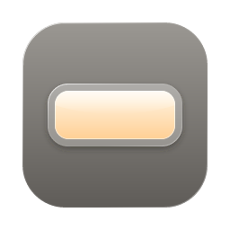
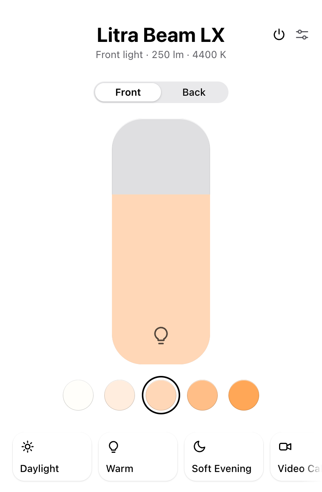
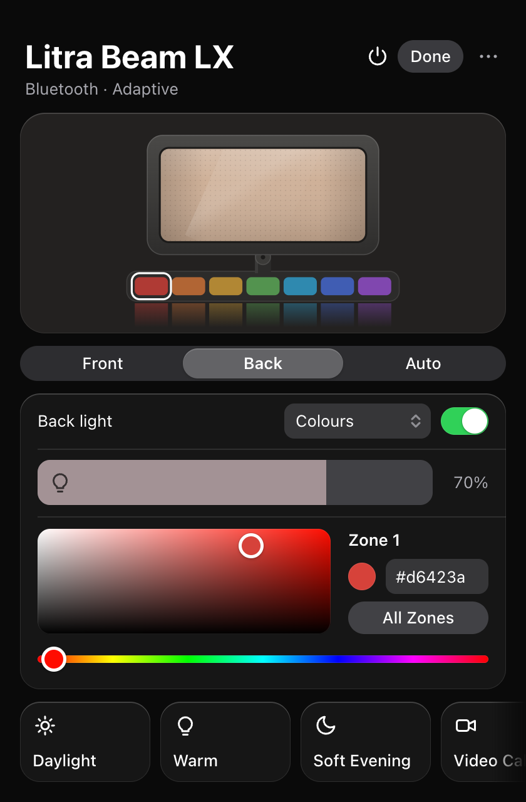
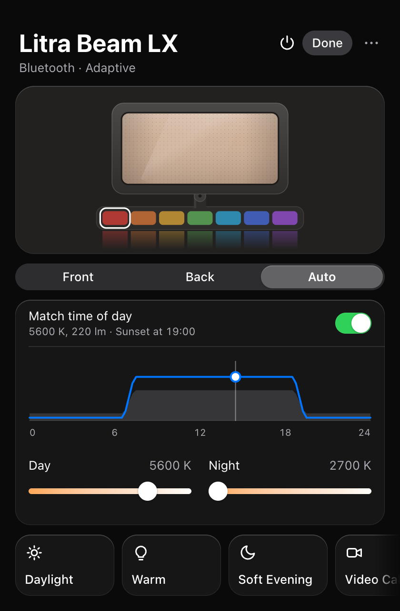

<p align="center">
  
</p>

<h1 align="center">Glint</h1>

<p align="center">
  A small Mac app for Logitech Litra lights.<br>
  USB or Bluetooth, straight from the menu bar. No G HUB.
</p>

<p align="center">
  
  
  
</p>

## Why

To control a Litra Beam LX from a computer, Logitech gives you G HUB: a large app with background services and an account prompt, for a desk light.

I wanted to turn the light on before a call, pick a colour for the back, and have it warm up in the evening. The light speaks the same HID++ protocol as Logitech mice, so this app sends those few commands itself.

## Features

- **One slider when that's all you need.** The simple view is a big brightness slider and a row of colour temperatures. The detailed view adds everything else.
- **Front light.** Power, brightness from 30 to 400 lm, temperature from 2700 to 6500 K.
- **Back light.** Power, brightness, and a colour for each of the 7 zones.
- **Match Screen.** The back light follows the colours on your display.
- **Adaptive.** Cool and bright by day, warm and dim at night, using sunrise and sunset for your location or fixed times.
- **Presets.** Six built in, plus your own.
- **Menu bar.** Toggle lights and apply presets without opening a window.
- **CLI.** One `glint` binary for scripts and shortcuts.

It reconnects on its own after sleep or a dropped Bluetooth link. The only network request it makes is a daily check for a new version on GitHub, which you can turn off in the menu bar.

## Install

With [Homebrew](https://brew.sh):

```sh
brew tap thevrus/glint https://github.com/thevrus/glint
brew install --cask glint
```

Or download the DMG from the [latest release](https://github.com/thevrus/glint/releases/latest) and drag Glint to Applications. The app is not notarized by Apple yet, so the first time you open a downloaded copy macOS blocks it: go to System Settings > Privacy & Security and click **Open Anyway**. The Homebrew install skips that step.

Needs macOS 14 or later, Apple silicon or Intel. Glint updates itself: when a new version is out, the menu bar menu shows **Install Glint x.y.z and Restart**. Until the app is signed with a Developer ID, macOS asks for Screen Recording permission again after each update if you use Match Screen.

Then connect the light by USB, or pair it in System Settings > Bluetooth, quit G HUB if it is running, and open the app.

## Command line

```sh
cargo install --path core
```

```sh
glint                      # current state
glint on
glint off
glint brightness 250       # lumens, 30 to 400
glint temp 4400            # kelvin, 2700 to 6500
glint back-on
glint back-brightness 70   # percent
glint back-color ff5a3c    # all zones
glint back-color ff5a3c 3  # zone 3 only, 1 to 7 from the left
glint devices              # list connected lights
```

## Supported lights

| Light | Connection | Status |
| --- | --- | --- |
| Litra Beam LX | Bluetooth, USB | Developed and tested on this |
| Litra Beam | USB, Bluetooth | Recognised, untested |
| Litra Glow | USB | Recognised, untested |

macOS only for now. The code is Tauri and hidapi, so Windows and Linux may build, but nobody has tried.

## Troubleshooting

**"Light not connected".** Check the light is on and paired, and that G HUB is closed. Over Bluetooth, switching the light off and on usually brings it back.

**Brightness or colour jumps back.** Adaptive is on. Turn it off in the Auto tab or from the menu bar.

<details>
<summary><b>Development</b></summary>

Needs [Rust](https://rustup.rs), [Node.js](https://nodejs.org) 20+ and the Xcode Command Line Tools (`xcode-select --install`).

```sh
cd app
npm install
npm run tauri dev
```

To release, set `version` in `app/src-tauri/Cargo.toml`, commit, then push a matching tag (`git tag v0.2.0 && git push origin main v0.2.0`). The release workflow builds the universal DMG, publishes the signed update, and bumps `Casks/glint.rb`.

| Path | What |
| --- | --- |
| `core/` | `glint-core`: the protocol library and the `glint` CLI. Depends only on `hidapi`. |
| `app/src-tauri/` | Tauri backend: device thread, presets, adaptive mode, Match Screen, menu bar. |
| `app/src/` | Frontend in plain TypeScript, no framework. |
| `litra.swift` | The original single-file IOKit prototype, kept for reference. |

Settings and presets live in `~/Library/Application Support/dev.glint.desktop/config.json`.

</details>

<details>
<summary><b>Protocol notes</b></summary>

- Commands are HID++ 2.0 long reports (report ID `0x11`, 20 bytes) on the vendor usage page `0xff43`.
- Feature indexes differ between USB and Bluetooth firmware, so they are looked up at connect time through `IRoot.GetFeature`. Illumination is feature `0x1990`; back light power and brightness is `0x8040`.
- The feature ID for back zone colours hasn't been identified. The code uses the fixed index `0x0c` documented by [litra-rs](https://github.com/timrogers/litra-rs), which works on the Beam LX.

</details>

## Disclaimer

An independent project, not affiliated with or endorsed by Logitech. Litra and G HUB are trademarks of Logitech.
